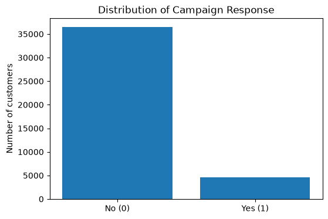
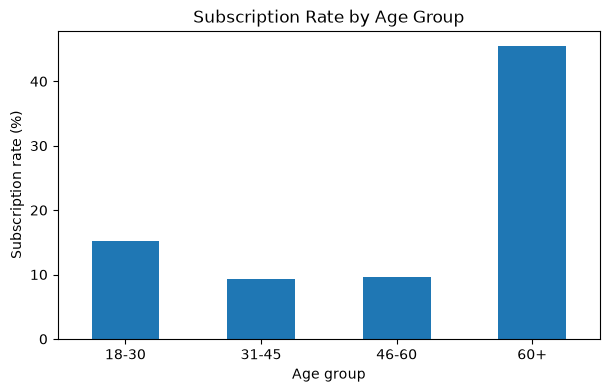
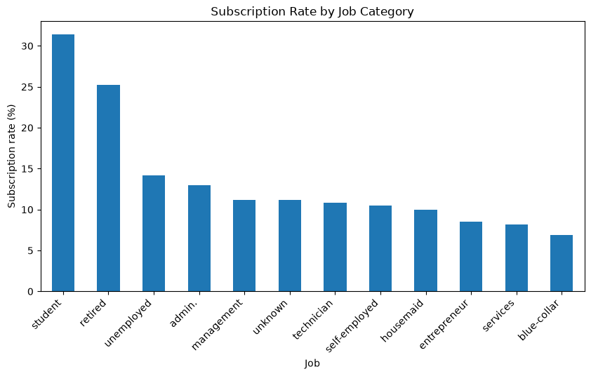
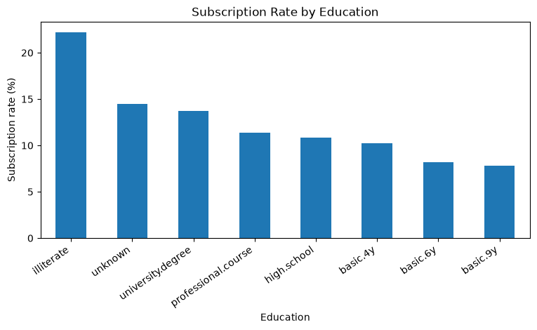
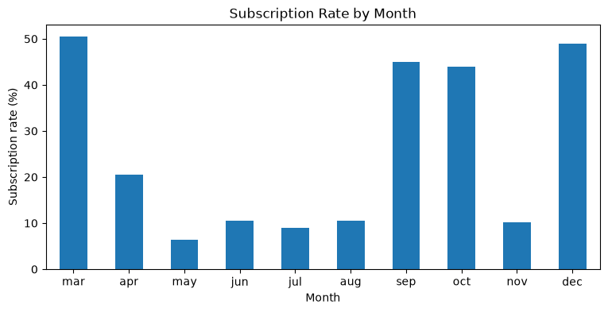
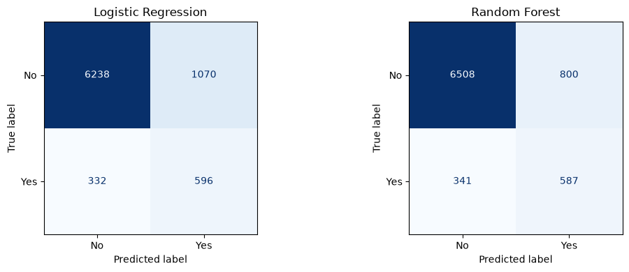
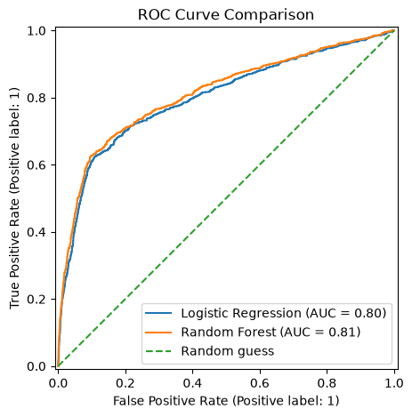
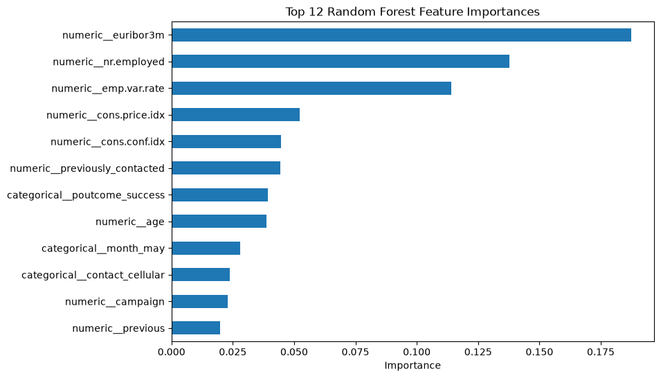

# Marketing Campaign Response Prediction & Customer Targeting


A machine learning project that predicts whether a bank customer is likely to subscribe to a term deposit following a direct-marketing campaign. The project uses exploratory data analysis, feature engineering, data preprocessing, classification models and model evaluation to identify customer-response patterns and support more effective campaign targeting.

## Project Overview

| Item | Details |
|---|---|
| Project domain | Banking, Marketing Analytics and Customer Targeting |
| Problem type | Binary classification |
| Dataset | UCI Bank Marketing – `bank-additional-full.csv` |
| Target variable | `y` (renamed to `target`; `yes` = 1, `no` = 0) |
| Models | Logistic Regression and Random Forest |
| Evaluation metrics | Accuracy, Precision, Recall, F1-score and ROC-AUC |
| Tools and libraries | Python, Pandas, NumPy, Matplotlib, Scikit-learn and Jupyter Notebook |

## Business Problem

Banks use direct-marketing campaigns, such as telephone calls, to encourage customers to subscribe to term deposits. Contacting every customer can require considerable time and resources. A predictive model can help estimate which customers are more likely to subscribe, allowing campaign teams to prioritise outreach more effectively.

The objective of this project is to use historical customer, campaign and economic information to predict the subscription response (`yes` or `no`). The model is intended as a decision-support tool; the final campaign strategy and prediction threshold should depend on factors such as contact costs, available campaign capacity and the value of a successful subscription.

## Dataset

The project uses the **Bank Marketing** dataset, specifically `bank-additional-full.csv`, from the UCI Machine Learning Repository.

- Original dataset size: **41,188 rows and 21 columns**.
- Duplicate records identified: **12**.
- Records after removing exact duplicates: **41,176**.
- Target distribution after cleaning:
  - `no`: **36,537** (approximately **88.73%**)
  - `yes`: **4,639** (approximately **11.27%**)
- The CSV file is semicolon-separated (`;`).

The variables include customer demographics, contact information, campaign history, previous campaign outcomes and economic indicators. The target records whether the customer subscribed to a term deposit.

## Project Workflow

1. Import the required Python libraries and load the dataset.
2. Inspect the dataset structure, data types, missing values and duplicate records.
3. Remove exact duplicate rows and encode the target variable as 0 and 1.
4. Perform exploratory data analysis to understand the response distribution and subscription rates across customer groups and campaign months.
5. Create useful features, including `age_group` and `previously_contacted`.
6. Prepare the feature matrix and target variable.
7. Split the data into training and testing sets using an 80:20 split with stratification (`random_state=42`).
8. Build preprocessing pipelines for numerical and categorical variables.
9. Train Logistic Regression and Random Forest classifiers using balanced class weights.
10. Evaluate both models using classification metrics, confusion matrices, classification reports, ROC curves and feature importance.
11. Interpret the results in the context of marketing campaign planning.

## Exploratory Data Analysis

### 1. Campaign Response Distribution

The target variable is imbalanced: approximately 88.73% of customers did not subscribe, while 11.27% subscribed. This class imbalance makes it important to evaluate the models using metrics beyond accuracy.



### 2. Subscription Rate by Age Group

The `60+` age group has the highest observed subscription rate among the age bands created in the notebook (**45.54%**).



### 3. Subscription Rate by Job Category

In the job-category comparison, students (**31.43%**) and retired customers (**25.26%**) show the highest observed subscription rates among the displayed categories.



### 4. Subscription Rate by Education

The chart compares observed subscription rates across the education categories in the dataset.



### 5. Subscription Rate by Campaign Month

March (**50.55%**), December (**48.90%**), September (**44.91%**) and October (**43.93%**) show the highest observed subscription rates in the monthly comparison.



These findings describe associations in the historical dataset. They do not establish that age, occupation, education or campaign month causes a customer to subscribe.

## Feature Engineering and Modelling Decisions

### Feature Engineering

- **`age_group`:** Age is grouped into four categories: `18-30`, `31-45`, `46-60` and `60+` to make customer-segment comparisons easier.
- **`previously_contacted`:** In the dataset, `pdays = 999` indicates that the customer was not previously contacted in an earlier campaign. The notebook creates a binary indicator (`1` if previously contacted, otherwise `0`) and removes `pdays` so that 999 is not treated as an ordinary number of days.

### Avoiding Data Leakage

The `duration` variable is excluded from model training because it represents the duration of the current call and is only known after the call has taken place. Including it would introduce information that would not be available when selecting customers to contact before a campaign call.

### Train-Test Split

The cleaned data is divided into:

- **80% training data:** 32,940 records.
- **20% testing data:** 8,236 records.

The split uses `stratify=y` to preserve the target-class proportions in both sets.

### Data Preprocessing

Preprocessing is implemented using Scikit-learn pipelines and a `ColumnTransformer`:

- **Numerical features:** missing values are imputed using the median and features are standardised using `StandardScaler`.
- **Categorical features:** missing values are imputed using the most frequent category and variables are encoded using `OneHotEncoder`.
- Preprocessing is fitted on the training data and then applied to the test data to avoid information leakage from the test set.
- Recorded `unknown` categories are retained as categories rather than automatically treated as missing values.

## Machine Learning Models

Two classification algorithms are trained and compared:

### 1. Logistic Regression

Used as a baseline classification model. The model uses `class_weight="balanced"` and `max_iter=1000` to account for the imbalanced target and support convergence.

### 2. Random Forest

An ensemble model that combines multiple decision trees and can capture non-linear patterns. The notebook uses the following settings:

- `n_estimators=150`
- `max_depth=12`
- `min_samples_split=5`
- `min_samples_leaf=2`
- `class_weight="balanced"`
- `random_state=42`

## Model Evaluation and Results

The models are evaluated on the held-out test set using Accuracy, Precision, Recall, F1-score and ROC-AUC.

| Model | Accuracy | Precision | Recall | F1-score | ROC-AUC |
|---|---:|---:|---:|---:|---:|
| Logistic Regression | 0.830 | 0.358 | **0.642** | 0.460 | 0.800 |
| Random Forest | **0.861** | **0.423** | 0.633 | **0.507** | **0.812** |

**Interpretation:** Random Forest achieves higher accuracy, precision, F1-score and ROC-AUC in this experiment. Logistic Regression achieves slightly higher recall, identifying a marginally greater proportion of actual subscribers. Since the target classes are imbalanced, accuracy alone is not sufficient for selecting a model.

- **Accuracy:** proportion of all predictions that are correct.
- **Precision:** proportion of predicted subscribers who actually subscribed.
- **Recall:** proportion of actual subscribers identified by the model.
- **F1-score:** harmonic mean of precision and recall.
- **ROC-AUC:** measures how well the model distinguishes between the two classes across classification thresholds.

### Confusion Matrix Comparison



### ROC Curve



### Random Forest Feature Importance

The feature-importance chart shows which transformed input features contributed most to the Random Forest model's predictions. In this run, economic indicators such as `euribor3m`, `nr.employed` and `emp.var.rate` appear among the most important features.

Feature importance describes the model's predictive behaviour; it does not establish a causal relationship.



## Business Interpretation and Recommendations

The results suggest several ways a bank could use this type of analysis:

1. **Prioritise customer outreach:** use predicted probabilities to rank customers and help campaign teams organise calling lists.
2. **Consider customer segments:** review subscription patterns across age groups, job categories and campaign months when planning and evaluating campaigns.
3. **Balance precision and recall:** a higher-recall model may identify more potential subscribers but can also lead to more unsuccessful calls. A higher-precision model may reduce unnecessary calls but miss some potential subscribers.
4. **Select an appropriate threshold:** choose a decision threshold based on campaign capacity, contact costs and the value of a successful subscription.
5. **Validate on newer data:** check whether the patterns and model performance remain consistent in more recent campaigns before operational use.

## Repository Structure

The repository is organised as follows:

```text
MARKETING-CAMPAIGN-RESPONSE-PREDICTION/
│
├── IMAGES/
│   ├── figure_10.png
│   ├── figure_12.png
│   ├── figure_14.png
│   ├── figure_16.png
│   ├── figure_18.png
│   ├── figure_30.png
│   ├── figure_34.png
│   └── figure_36.png
│
├── Marketing_Campaign_Response_Prediction_Simplified.ipynb
├── README.md
└── bank-additional-full.csv
```

**Note:** The image directory is named `IMAGES` in uppercase. All image links in this README therefore use the exact case-sensitive path format `IMAGES/figure_name.png` so that they render correctly on GitHub.

## How to Run the Project

1. Clone the repository:

   ```bash
   git clone https://github.com/satsang-it/MARKETING-CAMPAIGN-RESPONSE-PREDICTION.git
   ```

2. Open the repository folder and install the required libraries:

   ```bash
   pip install pandas numpy matplotlib scikit-learn jupyter
   ```

3. Launch Jupyter Notebook:

   ```bash
   jupyter notebook
   ```

4. Open `Marketing_Campaign_Response_Prediction_Simplified.ipynb` and run the cells from top to bottom.

Keep `bank-additional-full.csv` in the same directory as the notebook. The notebook expects the dataset to be semicolon-separated.

## Limitations and Future Improvements

- The reported results are based on one stratified random train-test split. Cross-validation and time-based validation could provide stronger evidence of generalisation.
- The models use their default classification decision thresholds. Threshold tuning should be carried out using validation data and a clear business-cost framework.
- Customer behaviour and economic conditions may change over time, so model performance should be monitored on newer campaign data.
- Feature importance and customer-segment comparisons show associations and predictive patterns, not causal effects.
- Before real-world use, the model would require additional validation, monitoring, privacy and fairness reviews, and business approval.

Possible extensions include probability calibration, cross-validation, threshold optimisation, lift and gains analysis, cost-sensitive evaluation and testing on newer campaign data.

## Dataset Reference

This project uses the **Bank Marketing** dataset from the [UCI Machine Learning Repository](https://archive.ics.uci.edu/dataset/222/bank+marketing). Please retain the dataset attribution and review the repository's terms of use when redistributing the data.

## Disclaimer

This is an educational and portfolio project. It is not a production banking decision system and should not be used to make real customer decisions without further validation, governance and compliance review.
